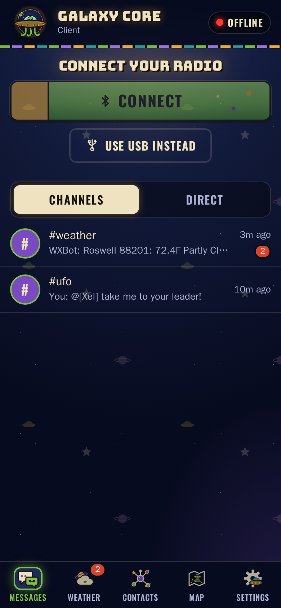
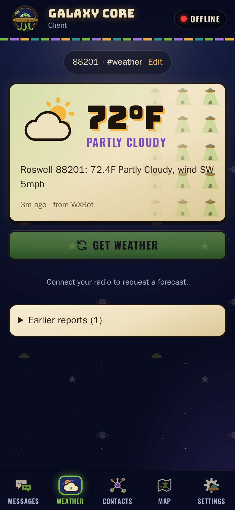
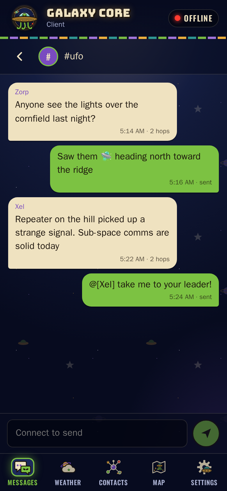
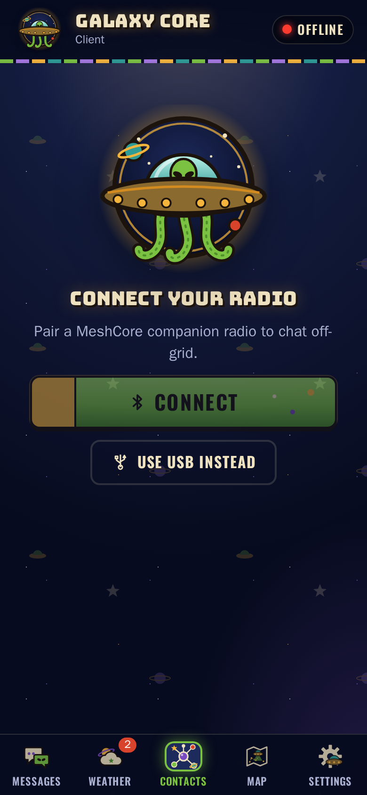
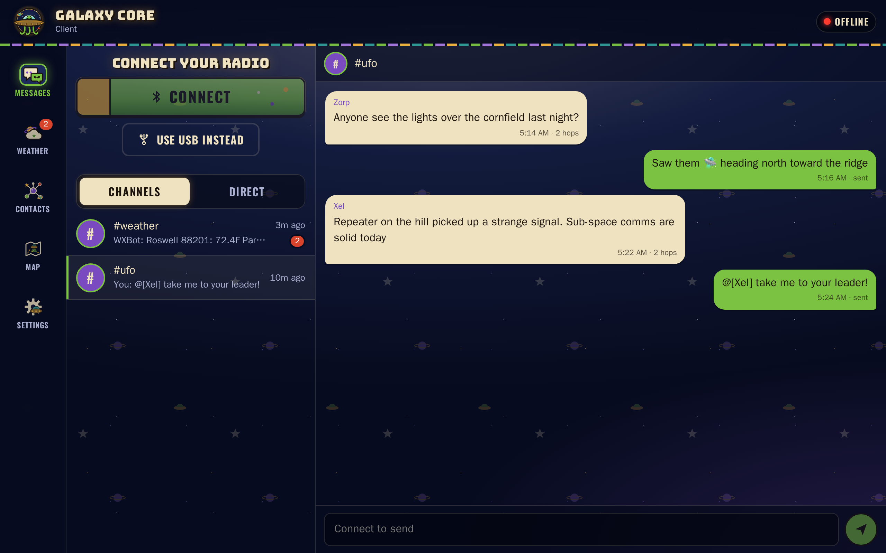

# 🛸 Galaxy Core Client

## ▶️ [Launch the app: kq4cin.github.io/meshcore_skinz_ufo](https://kq4cin.github.io/meshcore_skinz_ufo/)

Click the link above. The app runs in your web browser. There is nothing to download and no account to create.

---

## What is it?

An alien/UFO-themed **MeshCore companion-radio client** (the Galaxy Core skin of [MESHCORE_SKINZ](https://github.com/kq4cin/MESHCORE_SKINZ)) with a built-in **Weather** tab. Pair your radio and chat off-grid over LoRa, then ask your mesh weather bot for a forecast with one tap.

- 📡 **Connect your radio** — over Bluetooth or USB
- 💬 **Messages** — channels and direct messages, unread badges, and delivery status
- 🌦️ **Weather** — sends your ZIP code (or any text your bot responds to) to your weather bot's hashtag channel and shows the reply as a card
- 🗺️ **Network** — see nearby nodes (companions, repeaters, rooms), send adverts, and tap to DM
- 🪪 **Contact cards** — share and add contacts with the MeshCore app's link format: `meshcore://contact/add?name=…&public_key=…&type=1`
- 📍 **Map** — see contacts that share a GPS position on an OpenStreetMap map (tiles are fetched from OpenStreetMap and cached for offline use; this is the only network request the app makes)
- ⚙️ **Settings** — weather settings and device info (node name, battery, firmware, radio settings)
- 📶 **Works offline** — install it once and it keeps working with no connection
- 🔓 **No account, no server** — your messages and settings never leave your device

| Connect | Weather | Chat | Network |
| --- | --- | --- | --- |
|  |  |  |  |



---

## First time using it?

1. Open the [app link](https://kq4cin.github.io/meshcore_skinz_ufo/).
2. Enter your **ZIP code or location** — whatever your weather bot responds to (for example `30301` or `Atlanta, GA`).
3. Enter your weather bot's **hashtag channel** (default `#weather`). The app adds it to your radio for you.
4. Tap **Connect** and pick your radio. Its node name comes from the radio, so there's nothing to set up.
5. Open the **Weather** tab and tap **Get weather**.

You can change these later in **Settings**, or tap **Replay setup** to go through it again.

---

## Install it like an app (optional)

Installing puts an icon on your home screen and lets the app open **without internet**.

| Device | How to install |
|---|---|
| **Android** (Chrome) | Open the app → tap the **⋮** menu → **Install app** or **Add to Home screen** |
| **iPhone / iPad** ([Bluefy](https://apps.apple.com/app/bluefy-web-ble-browser/id1492822055)) | Open the app in Bluefy → use its menu to **Add to Home Screen** |
| **Windows / Mac** (Chrome or Edge) | Open the app → click the **install icon** in the address bar |

---

## Which browsers work?

| Platform | Bluetooth | USB |
| --- | --- | --- |
| Android – Chrome / Edge | ✅ | ✅ (OTG) |
| Desktop – Chrome / Edge | ✅ | ✅ |
| iPhone / iPad | ✅ via the [Bluefy](https://apps.apple.com/app/bluefy-web-ble-browser/id1492822055) browser | ❌ |
| Firefox / Safari | ❌ | ❌ |

---

## Are my messages saved?

Yes. Messages and settings save automatically in your browser.

- They are saved **on that device only**.
- Clearing your browser data (or **Settings → Clear message history**) will erase them.

---

## How the weather channel works

MeshCore hashtag channels use a shared key: the first 16 bytes of `SHA-256("#name")`. If the channel isn't already on the radio, the app installs it in the first free channel slot.

**Get weather** sends your ZIP or location text as-is on that channel. Any message on the channel from another node is treated as a weather report: the newest is shown as a card, with older replies listed below. To change the request format, use **Settings → Weather → Advanced**; `{zip}` is replaced with your ZIP or location.

---

## For developers

```bash
npm install
npm run dev            # http://localhost:5173/
npm test               # unit tests (Vitest)
npm run test:browser   # end-to-end tests at phone sizes (Playwright)
npm run build          # type-check + production build to dist/
npm run icons          # regenerate PNG icons from public/icons/*.svg
```

Planning notes, including the Elephant & Goldfish plan, are in [docs/PLAN.md](docs/PLAN.md).

Built on [`@liamcottle/meshcore.js`](https://github.com/meshcore-dev/meshcore.js) (MIT).
The Galaxy Core theme artwork (tentacled-UFO mascot, alien icons, cosmic stripes, abduction pattern) is an SVG recreation inspired by the supplied alien asset pack.

---

## License

[MIT](LICENSE)
